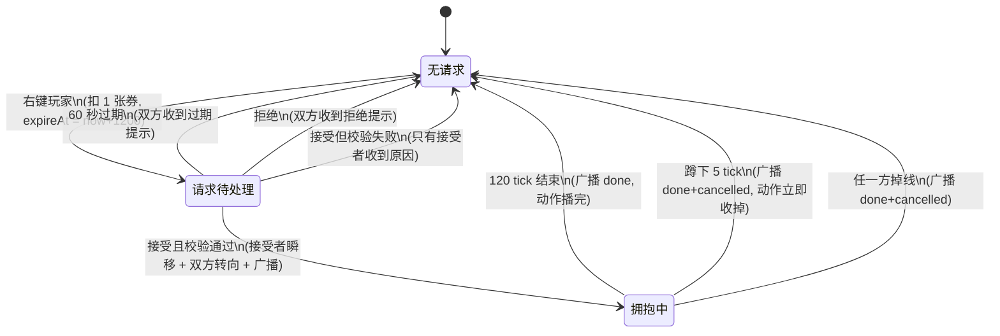
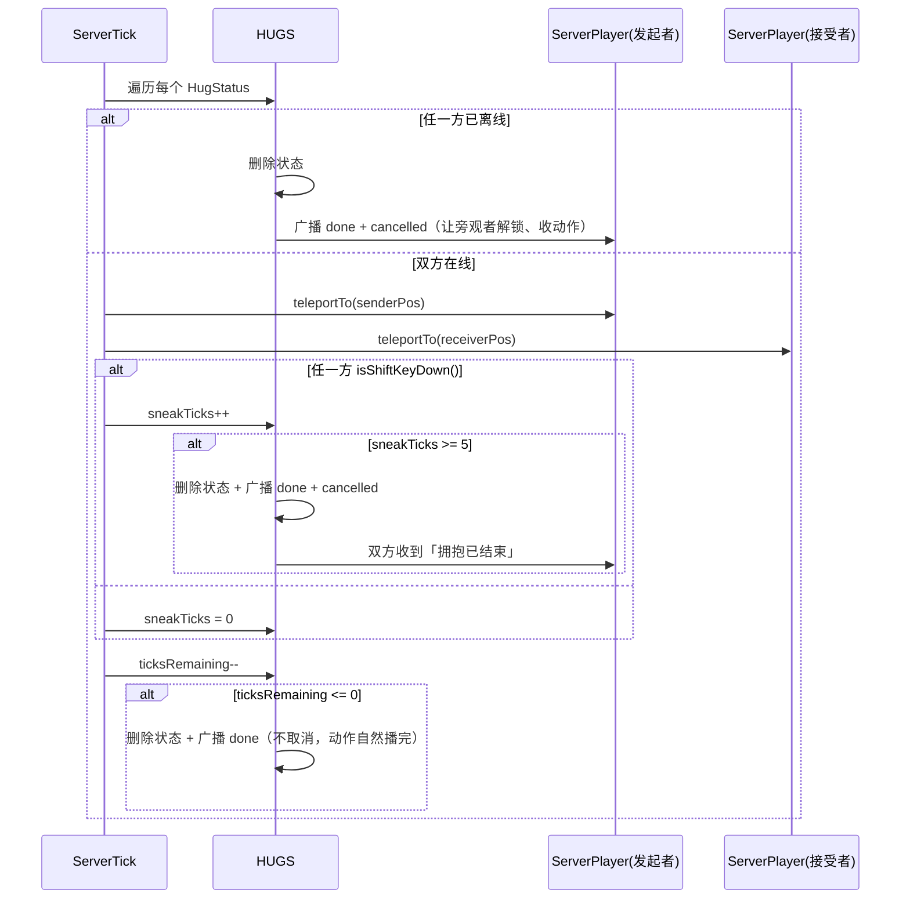

# 当前实现架构（1.20.1 / Forge）

> **文档定位**：本文描述**当前仓库里的实现**（as-built），是接手维护时最先读的一份。
>
> - 行为层面（玩家看到什么）以 [`behavior-spec.md`](behavior-spec.md) 为准；
> - 开发环境、构建与排错见 [`developing.md`](developing.md)；
> - [`original-design.md`](original-design.md) 是 **NeoForge 1.21 原版**的逆向规格（参考上游）；
> - [`port-plan.md`](port-plan.md) 是 v1.3 时期的迁移方案（历史文档，已被本文取代）。
>
> 维护约定：**改动协议、AT、动作数据、渲染矩阵时，必须同步更新本文对应章节**。

---

## 1. 一句话架构

> 服务端只做**权威状态机**（谁和谁、多久、用哪个动作），客户端只做**表现**（动作、姿态、相机、阴影）。
> 两端通过一个 `SimpleChannel` 通道同步 4 个字段；客户端用 playerAnimator 播放动作，并**接管玩家渲染**自己摆姿势。

三条不可破坏的边界：

| 边界 | 内容 | 违反的后果 |
|---|---|---|
| 服务端不碰动画库 | 服务端代码不 import `dev.kosmx.*`，不引用任何 client 类 | 专用服务端崩溃（`NoClassDefFoundError`） |
| 客户端不碰判定 | 客户端只信服务端发来的开始/结束包 | 双端状态不一致、可被改包利用 |
| 协议版本必须一致 | `PROTOCOL = "3"`，`mods.toml` 默认 `displayTest=MATCH_VERSION` | 连不上（红叉），这是有意的 |

---

## 2. 技术栈与版本

| 项 | 值 | 位置 |
|---|---|---|
| Minecraft | 1.20.1 | `gradle.properties` |
| Forge | 47.4.29 | `gradle.properties` |
| ForgeGradle | `[6.0.16,6.2)` | `build.gradle` |
| Gradle / JDK | 8.8 / 17 | `gradle/wrapper`、`java.toolchain` |
| 映射 | official 1.20.1 | `gradle.properties` |
| 动画库 | `dev.kosmx.player-anim:player-animation-lib-forge:1.0.2-rc1+1.20` | `build.gradle`（`fg.deobf`） |
| 协议版本 | `3` | `HugNetwork.PROTOCOL` |
| Access Transformer | `Camera#setPosition(Vec3)`（SRG `m_90581_`） | `META-INF/accesstransformer.cfg` |
| mixin | **无**（MixinGradle 插件保留，只为给 run 任务注入依赖 refmap 重映射参数） | `build.gradle` |

---

## 3. 模块职责

```
xyz.skyofsimba
├── Letscuddle                 入口：物品注册、创造栏、命令注册、首登发券
├── animation/
│   ├── HugAnimationEnum       动作枚举：稳定字符串 id + 显示名
│   └── AnimationManager       客户端：动作层注册、播放、停止（仅 CLIENT）
├── client/
│   └── HugCameraHandler       客户端：第三人称切换、相机偏移（仅 CLIENT）
├── command/
│   └── HugCommandHandler      服务端：请求/拥抱状态机、tick、命令、掉线清理
├── events/
│   └── RenderPlayerEventHandler  客户端：渲染接管、阴影抑制、头部可见性（仅 CLIENT）
├── item/
│   └── HugTicketItem          双端：抱抱券（发起请求 / Shift 切换动作 / tooltip）
└── network/
    ├── HugNetwork             双端：SimpleChannel 与注册
    ├── HugRenderPayload       双端：S2C 包（记录类，自带编解码）
    └── HugRenderClientHandler 仅客户端：收包后加锁/解锁/播动作（由 DistExecutor 调入）
```

| 类 | 运行侧 | 职责 | 持有的状态 |
|---|---|---|---|
| `Letscuddle` | 双端 | 注册 `letscuddle:hug_ticket`；加入创造栏 `TOOLS_AND_UTILITIES`；`RegisterCommandsEvent` 注册命令；首登发 16 张 | 无（`DeferredRegister` 静态） |
| `HugCommandHandler` | 服务端 | 请求表、拥抱表、tick 推进、命令实现、掉线清理 | `REQUESTS`、`HUGS`（`ConcurrentHashMap`，只在服务端线程访问） |
| `HugTicketItem` | 双端（逻辑在服务端） | 右键发起；Shift+右键/空中切换动作；tooltip 显示当前动作 | 物品 NBT `Animation` |
| `HugNetwork` | 双端 | 建通道、注册包 | `SimpleChannel` |
| `HugRenderPayload` | 双端 | 线上格式；handler 里用 `DistExecutor` 隔离客户端 | 无 |
| `HugRenderClientHandler` | 仅客户端 | 解析 UUID、加/解锁、播/停动作 | 无（委托给下面两个） |
| `AnimationManager` | 仅客户端 | 注册动作层、播放/停止 | playerAnimator 的每玩家层 |
| `RenderPlayerEventHandler` | 仅客户端 | 取消原版渲染 + 自绘模型；阴影抑制；头部恢复 | `LOCKS`、`SHADOW_HIDDEN`、`HEAD_HIDDEN` |
| `HugCameraHandler` | 仅客户端 | 第三人称切换 / 还原；相机偏移 | `active`、`previous`（相机类型） |

---

## 4. 数据模型与状态机

### 4.1 三个内存结构

```java
// 服务端
Map<Pair<UUID,UUID>, HugRequest> REQUESTS;   // 有序 Pair：A→B 与 B→A 可并存（原行为 K12）
Map<Pair<UUID,UUID>, HugStatus>  HUGS;

record HugRequest(UUID senderId, UUID receiverId, long expireAt, HugAnimationEnum animation) {}

class HugStatus {
    UUID senderId, receiverId;
    Vec3 senderPos, receiverPos;      // 接受瞬间的位置，每 tick 回拉
    List<ServerPlayer> nearbyPlayers; // 广播快照（接受时同一维度 <64 格）
    int ticksRemaining;               // 120 → 0
    int sneakTicks;                   // 连续蹲下 tick，达 5 提前结束
}

// 客户端
Map<UUID, Lock> LOCKS;
record Lock(UUID partner, boolean hideHead, long expireAt);   // expireAt = gameTime + 200
```

### 4.2 生命周期总览



> 注意：状态机里没有「已接受但未开始」的中间态——接受成功即进入拥抱。

### 4.3 发起（服务端）

`HugTicketItem#interactLivingEntity`（非 Shift）→ `HugCommandHandler.startHugRequest(sender, receiver, animation)`：

1. `REQUESTS.containsKey(key)` → 给发起者发「你已经向他发送了一个拥抱请求」，**不扣券**，返回 false；
2. 否则写入 `HugRequest(..., expireAt = server.getTickCount() + 1200)`，返回 true；
3. 物品侧在 true 时：给对方发带按钮的请求消息 → 给发起者发成功消息 → `stack.shrink(1)`。

### 4.4 接受（判定顺序 = 行为，不可随意调换）

`/letscuddle acceptRequest <玩家>` 或点击聊天按钮 →

| 步骤 | 判定 | 失败时给谁什么消息 |
|---|---|---|
| 1 | 请求存在，且 `request.receiverId == 执行者` | 接受者：`invalid_request` |
| 2 | 这对玩家当前不在拥抱中（`HUGS` 不含 key） | 双方：`hug_in_progress_sender` / `hug_in_progress_receiver` |
| 3 | 两人在同一 `Level` 实例 | 接受者：`invalid_level` |
| 4 | `receiver.distanceTo(sender) <= 5.0` | 接受者：`too_far` |
| 5 | 落点可站立（见 §4.5） | 接受者：`unsafe_position` |
| 6 | —— | 双方：`sender_accepted` / `receiver_accepted`（绿色） |
| 7 | 接受者瞬移到落点，**双方** `lookAt` 对方眼睛 | —— |
| 8 | 建 `HugStatus`，向快照内玩家广播开始包 | —— |
| 9 | 删除请求 | —— |

第 6 步在 5 之后是刻意的（原版 K3 的修复）：站不住时不会先收到「已接受」。

### 4.5 落点与可站立判定

```java
// 接受者被摆到「发起者另一侧」1.3 格（原实现的方向，K4 有意保留）
delta = sender.position() - receiver.position();
horizontal = sqrt(delta.x² + delta.z²);
if (horizontal < 1e-4) return null;              // 两人完全重合 → 视为无法站立（K5 修复）
stand = sender.position() + (delta.x/horizontal, 0, delta.z/horizontal) * 1.3;

canStand: 脚下方盒 (x±0.3, y-0.1 … y, z±0.3) 内**有**碰撞
canPass : 身体盒   (x±0.3, y+0.1 … y+1.7, z±0.3) 内**无**碰撞
```

### 4.6 拥抱期间每 tick（`TickEvent.ServerTickEvent` END 阶段）



### 4.7 清理矩阵（改代码时对照这张表，别漏）

| 资源 | 建立于 | 正常结束 | 蹲下取消 | 掉线 | 客户端兜底超时(200t) | 退出世界 |
|---|---|---|---|---|---|---|
| `REQUESTS` 条目 | 发起 | 接受时删除 | —— | 掉线事件删除 | —— | 随服务端关闭 |
| `HUGS` 条目 | 接受 | tick 到期删除 | tick 内删除 | tick/掉线事件删除 | —— | 随服务端关闭 |
| 服务端广播 done | —— | `cancelled=false` | `cancelled=true` | `cancelled=true` | —— | —— |
| 客户端 `LOCKS` | 收开始包 | 收结束包删除 | 收结束包删除 | 收结束包删除 | 渲染事件里删除 | 客户端重连清空 |
| 客户端动作层 | 收开始包 | 自然播完 | `setAnimation(null)` | `setAnimation(null)` | 自然播完 | 随客户端 |
| 客户端 `SHADOW_HIDDEN` | 每帧渲染前 | `AFTER_ENTITIES` 恢复 | 同左 | 同左 | 同左 | `ClientTick` 兜底恢复 |
| 客户端 `HEAD_HIDDEN` | 第一人称藏头时 | 解锁后下一帧渲染恢复 | 同左 | 同左 | 同左 | 随客户端 |
| 相机类型 | 收开始包 | 收结束包还原 | 同左 | 同左 | 渲染事件还原 | `LoggingOut` 只清标记 |

---

## 5. 网络协议

### 5.1 通道

| 项 | 值 |
|---|---|
| 通道 id | `letscuddle:main` |
| 协议版本 | `3`（`PROTOCOL` 常量） |
| 建通道 | `NetworkRegistry.newSimpleChannel(id, () -> PROTOCOL, PROTOCOL::equals, PROTOCOL::equals)` |
| 注册时机 | `FMLCommonSetupEvent`（mod 总线） |
| 消息 id | `0` |

客户端与服务端版本不一致时，Forge 在握手阶段直接拒绝连接（`displayTest` 默认 `MATCH_VERSION`）。

### 5.2 `HugRenderPayload`（S2C，唯一一个包）

线上字段顺序**不可调换**：

| # | 类型 | 字段 | 语义 |
|---|---|---|---|
| 1 | `String` (`writeUtf`) | `sender` | 发起者 UUID 字符串 |
| 2 | `String` (`writeUtf`) | `receiver` | 接受者 UUID 字符串 |
| 3 | `boolean` | `done` | false = 开始，true = 结束 |
| 4 | `boolean` | `cancelled` | 仅 `done=true` 有意义：true 时客户端立即 `setAnimation(null)` |
| 5 | `String` (`writeUtf`) | `animation` | 动作 id（`normal` / `touch_head`）；结束包为空串 |

### 5.3 版本历史与兼容策略

| 版本 | 变更 | 后果 |
|---|---|---|
| v1 | 4 字段（sender/receiver/done/animation:int） | —— |
| v2 | 增加 `cancelled`（蹲下取消） | 不兼容 v1 |
| v3 | `animation` 由 `int`（ordinal）改为 `String`（稳定 id） | 不兼容 v2 |

**加字段/改字段的流程**：改 `HugRenderPayload` → `PROTOCOL` +1 → 更新本文 §5.2/§5.3 与 `behavior-spec.md` → 双端同版本测试。不要试图做跨版本兼容（匹配版本是刻意的防错）。

### 5.4 客户端隔离（K15）

`HugRenderPayload.handle` 里：

```java
context.enqueueWork(() ->
        DistExecutor.unsafeRunWhenOn(Dist.CLIENT,
                () -> () -> HugRenderClientHandler.handle(message)));
context.setPacketHandled(true);
```

`HugRenderClientHandler`、`AnimationManager`、`RenderPlayerEventHandler`、`HugCameraHandler` **只在物理客户端被加载**；专用服务端不会触碰任何 client 类。新增客户端逻辑时保持这个模式。

---

## 6. 客户端渲染管线

### 6.1 为什么要取消原版渲染

拥抱要求两人**正好面对面**、模型**互相贴合**，而原版 `PlayerRenderer` 只会用实体自身 yaw 渲染，且不接受「根节点位移」。所以在 `RenderPlayerEvent.Pre` 里 `setCanceled(true)`，自己 push 变换后重画模型。

代价（都是有意接受或已补偿的）：

| 丢掉的 | 处理 |
|---|---|
| 护甲 / 手持物 / 披风 / 鞘翅等 layer | 接受（拥抱期间不画，结束恢复） |
| 名字标签 | 接受 |
| 阴影 | **补偿**：拥抱期间隐藏（见 §6.4） |
| playerAnimator 自己的 body 根节点变换 | **补偿**：手动补 5 行（见 §6.3） |

### 6.2 矩阵链（一个符号都不能改）

```java
poseStack.pushPose();
poseStack.mulPose(Axis.XP.rotationDegrees(180.0F));                     // 模型空间 Y 向下 → 世界 Y 向上
poseStack.translate(0.0, -1.5, 0.0);                                     // 1.5 格高的模型原点拉回脚底
poseStack.mulPose(new Quaternionf().rotationY(radians(targetYaw)));      // 朝向伙伴
// ↓ body 根节点变换（等价 playerAnimator 在 setupRotations 里做的事）
if (animation.isActive()) {
    Vec3f p = animation.get3DTransform("body", POSITION, Vec3f.ZERO);
    poseStack.translate(p.x, p.y + 0.7, p.z);
    Vec3f r = animation.get3DTransform("body", ROTATION, Vec3f.ZERO);
    poseStack.mulPose(Axis.ZP.rotation(r.z));
    poseStack.mulPose(Axis.YP.rotation(r.y));
    poseStack.mulPose(Axis.XP.rotation(r.x));
    poseStack.translate(0.0, -0.7, 0.0);
}
renderPlayerModel(...);   // setupAnim 全部传 0 → 冻结姿势；renderToBuffer(8 参浮点颜色)
poseStack.popPose();
event.setCanceled(true);
```

`targetYaw = degrees(atan2(dz, dx)) - 90`，其中 `(dx, dz) = partner - self`。

> `PoseStack` 是**后乘**：最后调用的最先作用到顶点。把 `Rx(180)`/`translate`/`Ry` 的顺序写反，会得到镜像或悬空的模型。

### 6.3 为什么必须自己补 body 变换

`hug_normal_receiver` / `hug_touch_receiver` 的 `body.z = -1.0 / -0.75` 是「压进对方怀里」的全部来源。这段位移本来由 playerAnimator 的 `PlayerModelMixin` 在 `setupRotations` 阶段施加——而我们取消了整条 `PlayerRenderer#render`，那段就被跳过了。不补 = 两人之间空出约 1 格。

### 6.4 阴影：为什么隐藏而不是跟随

- 1.20.1 的阴影由 `EntityRenderDispatcher` 在**实体渲染器返回之后**、按**实体坐标**单独绘制（条件是 `!entity.isInvisible()`），私有方法且逐方块扫描，无法复用；
- 模型被 body 位移推离实体约 1 格，阴影留在原地 → 错位。

**做法**：渲染前把当事人 `setInvisible(true)`（只影响这一帧的阴影判定），在 `RenderLevelStageEvent.Stage.AFTER_ENTITIES` 恢复；另加 `ClientTickEvent` END 兜底。因为只改本帧，**没有装本模组的客户端完全不受影响**。

> 想做「阴影跟随模型」需要 mixin `@Redirect` 掉 dispatcher 的阴影调用，当前刻意不做（见 `decisions.md`）。

### 6.5 相机偏移（v1.5.1）

相机由 `Camera#setup` 按**实体**位置算好；模型却在实体位置 + 位移处，于是画面中心是空地。修法：

1. Access Transformer 把 `Camera#setPosition(Vec3)` 开成 public（SRG 名 `m_90581_`）；
2. `ViewportEvent.ComputeCameraAngles`（在 `Camera#setup` 之后、`LevelRenderer#renderLevel` 之前触发）里：

```java
if (!camera.isDetached()) return;                    // 只处理第三人称
if (!(camera.getEntity() instanceof AbstractClientPlayer p)) return;
if (!RenderPlayerEventHandler.isLocked(p)) return;
camera.setPosition(camera.getPosition().add(RenderPlayerEventHandler.modelOffset(p, partialTick)));
```

`modelOffset` 与 §6.2 的矩阵链严格对应：

```
dx =  px·cosθ + pz·sinθ
dz =  px·sinθ − pz·cosθ        (θ = radians(targetYaw), (px,pz) = body POSITION 的 x/z)
```

代入接受者（θ=90°，body z=-1）得 `(-1, 0)`：模型落在发起者面前 0.3 格，与渲染位置一致。

配套的服务端行为：**发起者也会转向接受者**（原先只有接受者转头），否则自动第三人称后镜头仍朝旧方向。

### 6.6 第三人称切换（`HugCameraHandler`）

| 时机 | 行为 |
|---|---|
| `lockPlayers` 且当事人是本地玩家 | 记下当前 `CameraType`，切换到 `THIRD_PERSON_BACK` |
| `unlockPlayers` / 客户端兜底超时 | 只有在视角**仍等于** `THIRD_PERSON_BACK` 时才还原；玩家中途按 F5 换过视角则不覆盖 |
| `ClientPlayerNetworkEvent.LoggingOut` | 只清 `active` 标记（避免把状态带进下个存档） |

### 6.7 头部可见性（K10）

第一人称拥抱时发起者 `hideHead=true` → `model.head.visible=false`。1.20.1 的 `PlayerRenderer` 不会自动重置这个标志（已验证源码），所以用 `HEAD_HIDDEN` 记录被改过的玩家，解锁后下一帧渲染时恢复 `true`。

---

## 7. 动画子系统

| 项 | 值 |
|---|---|
| 层 id | `letscuddle:animations` |
| 优先级 | `42` |
| 速度 | `SpeedModifier(0.5F)`（动作 JSON 61 tick → 实际约 122 tick ≈ 6.1 s，刚好比 120 tick 锁定略长） |
| 第一人称 | `FirstPersonMode.THIRD_PERSON_MODEL`，双臂显示、手持物隐藏 |
| 注册时机 | `FMLClientSetupEvent#enqueueWork` 里 `PlayerAnimationFactory.ANIMATION_DATA_FACTORY.registerFactory(...)` |

动作 id 映射（`HugAnimationEnum.id()` → 注册 id → 文件）：

| 枚举 | id（NBT / 网络） | 注册 id | 文件 |
|---|---|---|---|
| `NORMALHUG` | `normal` | `letscuddle:hug_normal_sender` / `..._receiver` | `normal_s.json` / `normal_r.json` |
| `TOUCHHEADHUG` | `touch_head` | `letscuddle:hug_touch_sender` / `..._receiver` | `touch_s.json` / `touch_r.json` |

注册 id 来自 JSON 里的 `name` 字段（**不是文件名**），解析时取小写。动作数据缺失时只打日志、不播（K19 兜底）。

动作 JSON 的四个不可动点见 [`behavior-spec.md`](behavior-spec.md) §8。

---

## 8. 数据与资源

| 资源 | 路径 | 说明 |
|---|---|---|
| 物品 | `letscuddle:hug_ticket` | 64 堆叠，创造栏 `TOOLS_AND_UTILITIES`，NBT 键 `Animation` |
| 配方 | `data/letscuddle/recipes/hug_ticket.json` | 十字：四角纸、上下淡蓝染料、中间粉染料 → 4 张 |
| 物品模型 | `assets/letscuddle/models/item/hug_ticket.json` | `item/generated` |
| 物品贴图 | `assets/letscuddle/textures/item/hug_ticket.png` | 64×64 |
| 模组 logo | `assets` 之外的 `hug_ticket.png`（jar 根） | `mods.toml` 的 `logoFile` |
| 语言 | `assets/letscuddle/lang/{zh_cn,en_us}.json` | 24 个 key（消息 19 + 动作名 2 + 物品 3） |
| 动作 | `assets/letscuddle/player_animation/*.json` | 4 份，见 §7 |
| 元数据 | `META-INF/mods.toml` | 依赖 forge / minecraft / playeranimator(side=CLIENT) |
| 资源包 | `pack.mcmeta` | `pack_format 15` |
| AT | `META-INF/accesstransformer.cfg` | 一行，SRG 名 |

命名空间统一 `letscuddle`；改 modid 需要同步：`gradle.properties`、`@Mod`、`mods.toml`、`assets/`、`data/`、语言 key 前缀、`HugNetwork` 通道 id、`AnimationManager.LAYER_ID`。

---

## 9. 线程与生命周期

- **服务端**：所有状态（`REQUESTS`、`HUGS`）只在服务端主线程读写；`ServerTickEvent` 的 END 阶段是唯一推进点。没有线程池、没有异步任务（原版的 60 秒线程池在移植时删除，见 K1/K2）。
- **客户端**：渲染事件在渲染线程；`ClientTickEvent` 在主线程；网络包经 `enqueueWork` 回到主线程。`LOCKS` / `SHADOW_HIDDEN` / `HEAD_HIDDEN` 三者都只在客户端线程访问，无需加锁。
- **连接生命周期**：服务端状态不持久化，重启即清空；客户端 `LOCKS` 有 200 tick 兜底，掉线/退世界后自动失效。

---

## 10. 扩展点

### 10.1 新增一种拥抱动作

1. `HugAnimationEnum` 追加常量（新 id，如 `fly`），**不要改已有 id**；
2. 放两份 JSON 到 `assets/letscuddle/player_animation/`，`name` 分别为 `hug_fly_sender` / `hug_fly_receiver`；
3. `AnimationManager.lookup` 里加一条映射；
4. 补两条语言 key（`letscuddle.animation.fly`）；
5. 更新 `behavior-spec.md`、§7 表格与 `CHANGELOG.md`。

不需要动协议（id 是字符串），也不需要改 NBT 格式。

### 10.2 改时长 / 距离 / 广播半径

`HugCommandHandler` 顶部的常量：`ANIM_TICKS`、`REQUEST_TIMEOUT_TICKS`、`MAX_DISTANCE`、`NEARBY_RADIUS`、`SNEAK_CANCEL_TICKS`。改完同步 `behavior-spec.md` 的数值表。

### 10.3 加一条客户端 → 服务端包（例如让玩家主动取消）

`SimpleChannel#registerMessage` 有 6 参重载可指定方向：
`registerMessage(id, Class, encoder, decoder, handler, Optional.of(NetworkDirection.PLAY_TO_SERVER))`；
服务端用 `context.getSender()` 取发送者并做权威校验。协议版本 +1。

---

## 11. 已知限制与设计取舍

| 项 | 说明 | 出处 |
|---|---|---|
| 无权限 / 冷却 / 无敌 / 摔落保护 | 产品决策，未做 | K14 |
| 拥抱中用 `teleportTo` 每 tick 回拉 | 会被传送拦截、反作弊、位移校正类模组打断 | 原设计 3.3 |
| 落点在发起者「另一侧」 | 有意保留原行为，第三人称看不出差别 | K4 |
| 模型略高约 6.7% | 没加原版的 `0.9375` 缩放 | K7 |
| 阴影被隐藏而非跟随 | 避免 mixin，见 §6.4 | v1.4 |
| 状态不持久化 | 重启清空；社交模组可接受 | K17 |
| 创造模式中键复制会丢 NBT | 复制出的券回到「普通拥抱」 | v1.5 |
| 首登发券用 `.dat` 存在性判定 | 崩服/断线可能重复发 | K20 |
